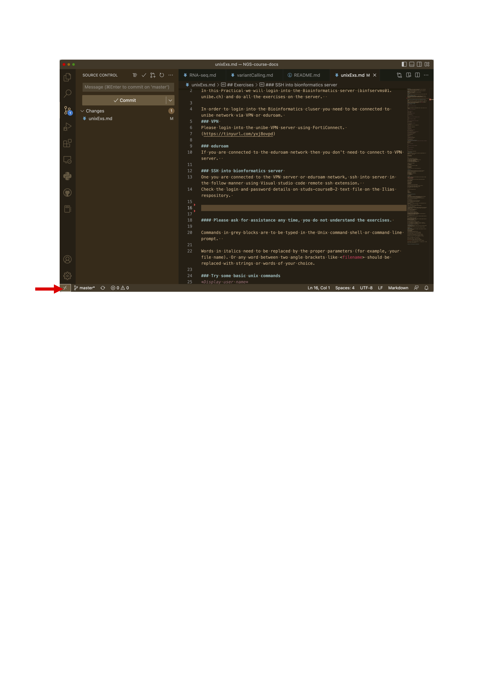
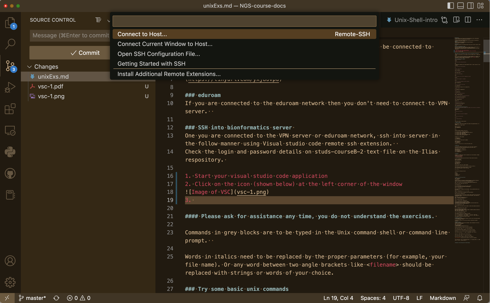
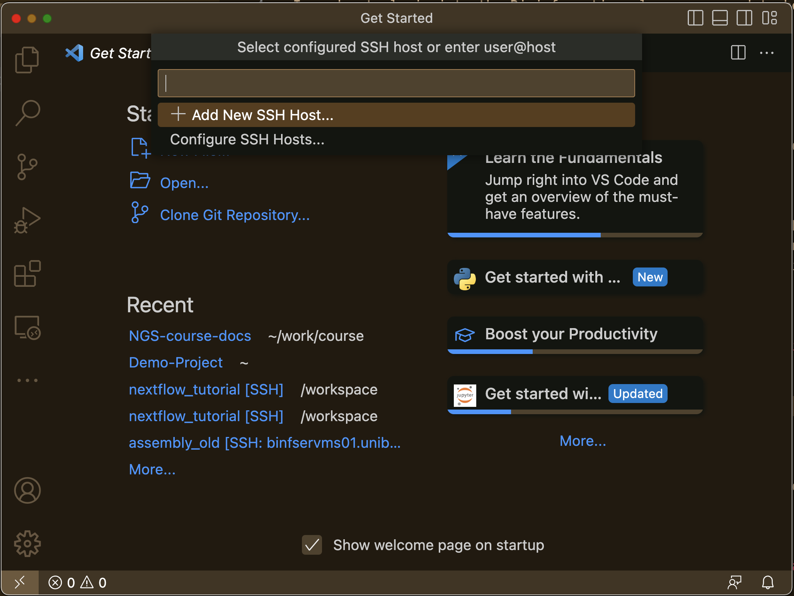
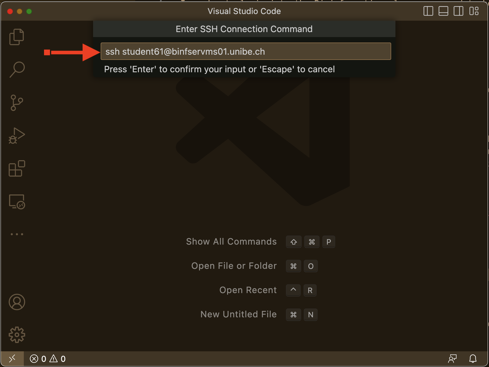
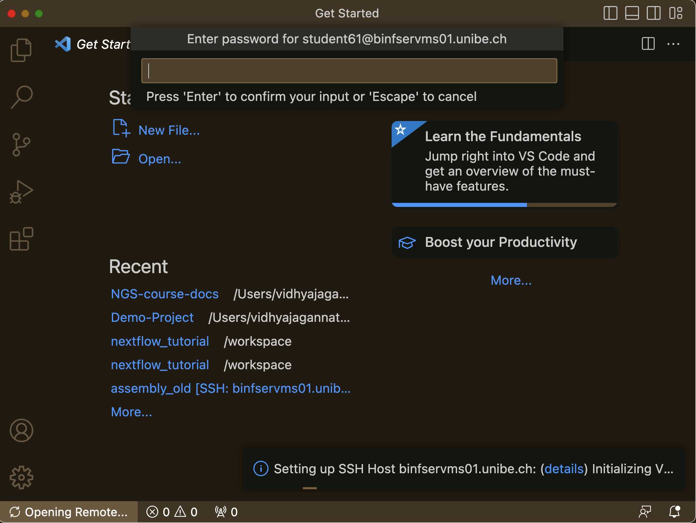
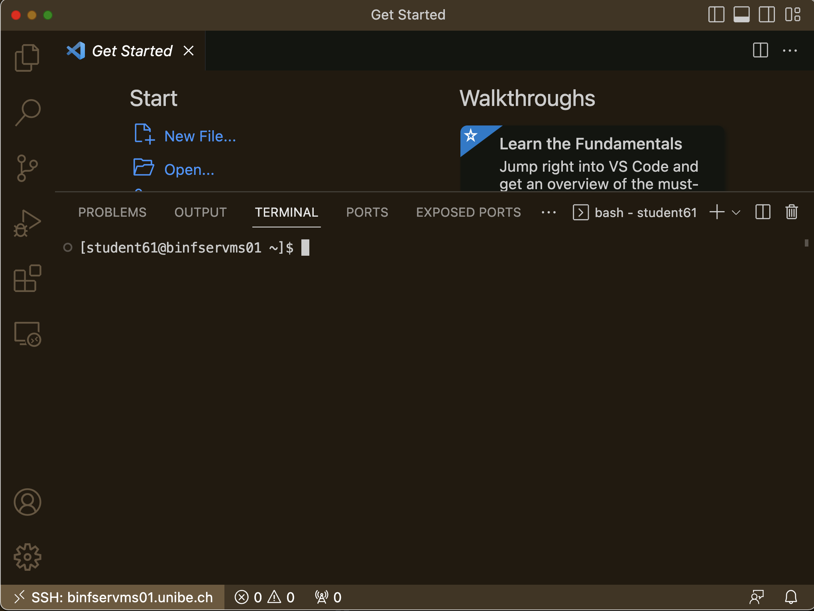

<!--
INSTRUCTOR NOTES (not rendered on GitHub)
Students need one file in /data/courses/courseB/UnixEx/:
  dog_chr5.fa   chromosome 5 (NC_049226.1) of UU_Cfam_GSD_1.0, soft-masked as distributed by NCBI (~88 Mb)
Preparation:
  B=https://ftp.ncbi.nlm.nih.gov/genomes/all/GCF/011/100/685/GCF_011100685.1_UU_Cfam_GSD_1.0
  wget $B/GCF_011100685.1_UU_Cfam_GSD_1.0_genomic.fna.gz
  module load SAMtools/1.13-GCC-10.3.0
  zcat GCF_011100685.1_UU_Cfam_GSD_1.0_genomic.fna.gz > genome.fa && samtools faidx genome.fa
  samtools faidx genome.fa NC_049226.1 > dog_chr5.fa && samtools faidx dog_chr5.fa
Checked 2026-11-12 against NCBI: EFNB3 gene = NC_049226.1:32,795,890-32,801,854 (+), transcript XM_038536724.1 has 5 exons,
last exon 32,799,600-32,800,557. Primer pair gives a 496 bp amplicon (fwd starts 32,799,428, rev ends 32,799,923).
chr5 GTF: 1,871 genes, 1,041 protein-coding; longest gene DAB1 (1,027,070 bp).
-->

# Unix Exercises: Getting to Know the Dog Genome

## Log in to the Bioinformatics server

In this practical we log in to the Bioinformatics server (login8.hpc.binf.unibe.ch) and do all the exercises there.

To log in to the Bioinformatics cluster you need to be connected to the unibe network via VPN or eduroam.

### VPN
Log in to the unibe VPN server using FortiConnect (https://tinyurl.com/yxj8ovpd).

### eduroam
If you are connected to the eduroam network you don't need the VPN.

### SSH into the Bioinformatics server
After connecting to either the VPN or eduroam, use Visual Studio Code's Remote SSH extension to access the server.

Find your login and password in the students-passwords text file in the ILIAS repository (https://ilias.unibe.ch/goto_ilias3_unibe_file_3222705_download.html).

1. Start Visual Studio Code.
2. Click the icon (shown below) in the bottom left corner of the window.

3. A sub-window opens as shown below. Click "Connect to Host".

4. Click "Add New SSH Host".

5. Fill in the login details as shown below (replace with your student ID).

6. Click connect and enter the password at the prompt.

7. Open a new terminal from the Terminal menu. You should see a window like the one below.


#### Please ask for help any time you don't understand the exercises.

Commands in grey blocks are typed at the Unix command line (the terminal window above).

Words between angle brackets, like `<filename>`, must be replaced with a name of your choice (without the brackets).

## Part 1: First commands

*Who am I, and where am I?*
```shell
whoami
pwd
```
`pwd` shows something like `/home/student36`. This is your **home** directory.

*List the files in the directory*
```shell
ls
```
*Print text, the date, and the commands you typed so far*
```shell
echo "Hello world"
date
history
```
*Read the manual of a command* (press `q` to leave it)
```shell
man ls
```

## Part 2: Files and directories

Let's create a small project directory as you would for the course data.

*Create a directory and go into it*
```shell
mkdir weimaraner
cd weimaraner
pwd
```
*Create empty files.* We pretend these are the sequencing files of the three affected puppies (WE0025, WE0028, WE0029). Each dog has two read files, R1 and R2.
```shell
touch WE0025_R1.fastq.gz WE0025_R2.fastq.gz
touch WE0028_R1.fastq.gz WE0028_R2.fastq.gz
touch WE0029_R1.fastq.gz WE0029_R2.fastq.gz
ls
ls -l
```
*Copy, rename and delete a file*
```shell
cp WE0025_R1.fastq.gz test.fastq.gz
mv test.fastq.gz renamed.fastq.gz
ls
rm renamed.fastq.gz
ls
```
*Make a sub-directory, move files into it, and remove it again*
```shell
mkdir raw_reads
mv WE00*_R1.fastq.gz raw_reads/
ls raw_reads
rmdir raw_reads
```
Did `rmdir` work? No! A directory must be empty before `rmdir` can remove it.
```shell
mv raw_reads/* .
rmdir raw_reads
ls
```

*Moving around*
```shell
mkdir results
cd results
pwd
cd ..
pwd
cd
pwd
```
`..` means "one directory up". `cd` on its own always takes you home. When you are lost, type `pwd`.

### Command options
Most commands accept **options** that change what they do.
```shell
cd ~/weimaraner
ls -l     # long format: permissions, owner, size, date
ls -lh    # sizes in human-readable units (K, M, G)
ls -lt    # sorted by modification time
ls -a     # also show hidden files (names starting with .)
ls -1     # one file per line
```

### Wildcards
`*` matches any number of characters, `?` exactly one character, and `[...]` one of the characters in the brackets.
```shell
ls *.fastq.gz
ls *_R1.fastq.gz
ls WE0025*
ls WE002[59]_R1.fastq.gz
ls WE002?_R2.fastq.gz
```
Question: write **one** `ls` command that lists only the R2 files of WE0028 and WE0029.

### Redirection and pipes
`>` writes the output of a command into a file (overwriting it!), `>>` appends to a file, and `|` (pipe) sends the output of one command into the next.
```shell
ls *_R1.fastq.gz > samples.txt
cat samples.txt
echo "WE0030_R1.fastq.gz" >> samples.txt
cat samples.txt
ls *.fastq.gz | wc -l
```
`wc -l` counts lines. How many FASTQ files do we have?

#### To remember
1. There is no "undo" and no trash bin. `rm` deletes permanently.
2. `>` overwrites a file without asking.
3. File names are case-sensitive: `File1.txt` and `file1.txt` are different files.
4. Don't use spaces in file names.

## Part 3: How many genomes have been sequenced?

NCBI keeps a table of all reference-quality (RefSeq) genome assemblies. Let's explore it.

```shell
cd ~
mkdir GenomeStats
cd GenomeStats
wget https://ftp.ncbi.nlm.nih.gov/genomes/refseq/assembly_summary_refseq.txt
ls -lh
```
Have a quick look with `less` (press `q` to exit):
```shell
less -S assembly_summary_refseq.txt
```
It is a tab-separated table. The column names are on the second line. To read them as a numbered list:
```shell
head -n 2 assembly_summary_refseq.txt | tail -n 1 | tr '\t' '\n' | nl | less
```
Question: do you understand each step of this pipe? Run it piece by piece (first only `head -n 2 assembly_summary_refseq.txt`, then add `| tail -n 1`, and so on) to see what each command adds.

#### Dog genomes
Column 6 is the NCBI taxonomy ID; the dog's is 9615. Column 8 is the species name.
```shell
awk -F'\t' '$6 == "9615"' assembly_summary_refseq.txt
```
Keep the header line too:
```shell
awk -F'\t' 'NR == 2 || $6 == "9615"' assembly_summary_refseq.txt
```
- `-F'\t'` tells awk that columns are separated by tabs.
- `NR == 2` is true for line number 2 (the header).
- `||` means OR.

That's hard to read. Select only the interesting columns: 5 (refseq_category), 9 (breed), 16 (assembly name), 26 (genome size) and 28 (GC %):
```shell
awk -F'\t' '$6 == "9615"' assembly_summary_refseq.txt | cut -f 5,9,16,26,28
```
Questions:
1. How many dog genomes are in RefSeq? Which breeds were sequenced?
2. Which one is the **reference genome**? From which breed is it?
3. The genome sizes differ by almost 170 Mb. Is the boxer's genome really that much smaller? (Hint: what else could make an assembly smaller?)

We will use the **UU_Cfam_GSD_1.0** assembly for the rest of the course.

#### Your favourite organism
Find the genome of the species **you** work with, or your favourite animal or plant. Search for its name with `grep` (`-i` ignores upper/lower case):
```shell
grep -i "felis catus" assembly_summary_refseq.txt | cut -f 8,9,16,26,28,36
```
Column 36 is the number of protein-coding genes. Write down the species, genome size, GC % and number of protein-coding genes for your organism in the class table (link on ILIAS).

#### Statistics on all genomes
How many genomes per group (column 25)? `tail -n +3` skips the two header lines.
```shell
tail -n +3 assembly_summary_refseq.txt | cut -f 25 | sort | uniq -c
```
- `cut -f 25` takes column 25.
- `sort` puts identical values next to each other.
- `uniq -c` counts identical lines that are next to each other.

Question: how many mammalian genomes (`vertebrate_mammalian`) are there?

Which mammal has the highest GC content?
```shell
cut -f 8,25,28 assembly_summary_refseq.txt | grep vertebrate_mammalian | sort -t$'\t' -k3,3nr | head -n 5
```
- `-t$'\t'` sets the column separator to tab.
- `-k3,3nr` sorts by column 3, numerically (`n`), in reverse order (`r`).

Question: which mammal has the **lowest** GC content?

#### Question of the day
Invertebrates are said to have lower GC content than vertebrates. Is this true? Compute the percentage of genomes with GC < 40% in each group:
```shell
awk -F'\t' '$25 ~ /^vertebrate_/ { total++; if ($28+0 < 40) count++ } END { print (count/total)*100, count, total }' assembly_summary_refseq.txt
awk -F'\t' '$25 == "invertebrate" { total++; if ($28+0 < 40) count++ } END { print (count/total)*100, count, total }' assembly_summary_refseq.txt
```
- `$25 ~ /^vertebrate_/` means column 25 starts with "vertebrate_".
- `total++` counts all genomes in the group; `count++` only those with GC < 40.
- `$28+0` turns column 28 into a number.
- The output is: percentage, count with GC < 40, total.

## Part 4: Dog chromosome 5

Now we look at the DNA itself. On Day 3 you will find the cause of the puppies' disease on **chromosome 5**. Copy the chromosome sequence:

```shell
cd ~
mkdir dogChr5
cd dogChr5
cp /data/courses/courseB/UnixEx/dog_chr5.fa .
ls -lh
```

### The sequence (FASTA)
```shell
head -n 3 dog_chr5.fa
grep ">" dog_chr5.fa
```
Questions:
1. What does the line starting with `>` contain?
2. How many letters are on each sequence line?

*How long is chromosome 5?* `grep -v ">"` removes the header line, `tr -d '\n'` removes line breaks, and `wc -c` counts characters.
```shell
grep -v ">" dog_chr5.fa | tr -d '\n' | wc -c
```

*Base composition.* `tr -cd 'Gg'` deletes every character that is **not** G or g.
```shell
grep -v ">" dog_chr5.fa | tr -cd 'Aa' | wc -c
grep -v ">" dog_chr5.fa | tr -cd 'Cc' | wc -c
grep -v ">" dog_chr5.fa | tr -cd 'Gg' | wc -c
grep -v ">" dog_chr5.fa | tr -cd 'Tt' | wc -c
grep -v ">" dog_chr5.fa | tr -cd 'Nn' | wc -c
```
Questions:
1. Are there about as many A as T, and as many C as G? Why would you expect that? (Hint: two strands.)
2. Calculate the GC % of chromosome 5. Does it match the genome-wide GC of the assembly in Part 3?
3. N means "unknown base" (a gap in the assembly). This genome was assembled with long reads. Would you expect many or few Ns?

*Upper and lower case.* Look at a few sequence lines from the middle of the chromosome:
```shell
sed -n '400000,400010p' dog_chr5.fa
```
Some stretches are written in **lowercase**. NCBI uses lowercase to mark **repeats** (transposons and other repetitive DNA). What fraction of chromosome 5 is repetitive?
```shell
grep -v ">" dog_chr5.fa | tr -cd 'acgt' | wc -c
grep -v ">" dog_chr5.fa | tr -cd 'ACGT' | wc -c
```
Question: why are repeats a problem when we map short sequencing reads to the genome?

**For the brave.** Calculate GC % in one command with awk:
```shell
awk '!/^>/{gc+=gsub(/[gGcC]/,""); at+=gsub(/[aAtT]/,"")} END{printf "%.2f%%\n", gc*100/(gc+at)}' dog_chr5.fa
```

### A question to think about until Day 3
On Day 3 you will find that the puppies carry a variant in a gene called *EFNB3*. Go to https://www.ncbi.nlm.nih.gov/gene and search for *EFNB3* in human, mouse, dog and chicken (*Gallus gallus*). What do you notice for the chicken? Birds move their wings **together**, while dogs move their legs **one after the other**. Could that be related?

## Save your work
```shell
history > ~/unix_day1_history.txt
```

# Welcome to the exciting world of genome data analysis!
